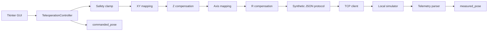

# Teleoperation Control & Compensation

A simulator-first Python project that demonstrates the software architecture behind a robot
teleoperation interface: TCP communication, threaded telemetry reception, coordinate transforms,
planar compensation, soft limits, motion commands, and a Tkinter GUI.

This repository is a public portfolio reconstruction of a larger robotics prototype by
**Klaudia Senator**. It preserves the engineering ideas while deliberately excluding deployment
details. The protocol, network settings, calibration values, limits, and simulator are synthetic.
It is not an interface for any production robot or medical device.

## What it demonstrates

- TCP connection management and a background RX thread
- newline-delimited telemetry parsing
- separate `commanded_pose` and `measured_pose` state
- absolute, delta, and per-axis jog control
- scene-to-robot coordinate mapping
- configurable XY swap, signs, and planar rotation
- Z tilt compensation based on X/Y displacement
- outgoing R-axis compensation based on X/Y displacement
- scene-space X/Y soft limits and optional fixed-Z plane
- local fake robot that echoes accepted commands as telemetry
- pure, independently tested math and safety modules

## Architecture



The controller pipeline is intentionally explicit:

```text
requested scene pose
  → scene-space safety limits
  → XY swap/sign/rotation
  → Z tilt compensation
  → optional Y/Z and R/W output mapping
  → R compensation on the outgoing R channel
  → synthetic protocol encoding
```

Telemetry follows a separate path and updates only `measured_pose`. This fixes the ambiguity of
using one mutable pose for both a requested target and the robot's reported position.

## Compensation model

The transformed planar position `(X, Y)` is measured relative to a captured origin `(X0, Y0)`.
The public demo implements the same linear model for Z correction:

```text
Z_corrected = Z + sign_z · [kx_z · (X − X0) + ky_z · (Y − Y0)]
```

and an independent correction on the outgoing R channel:

```text
R_corrected = R_out + sign_r · [kx_r · (X − X0) + ky_r · (Y − Y0)]
```

Origin capture and the explicit synthetic zero-pose command are separate operations. Capturing an
origin never sends a movement command.

## Run the demo

Python 3.10 or newer is required. Tkinter is included with standard Python installers on Windows
and macOS; some Linux distributions package it separately.

```bash
python -m venv .venv
# Windows: .venv\Scripts\activate
# macOS/Linux: source .venv/bin/activate
python -m pip install -e ".[dev]"
```

Start the fake robot in the first terminal:

```bash
teleoperation-simulator
```

Start the GUI in a second terminal:

```bash
teleoperation-gui
```

Connect to `127.0.0.1:8765`, then try jog, delta, or absolute movement. The simulator immediately
returns each accepted pose as telemetry, so commanded and measured values can be compared in the
GUI. Both the GUI and simulator intentionally restrict interactive use to the loopback interface.

## Synthetic public protocol

Commands and telemetry use newline-delimited JSON. A movement command looks like this:

```json
{"pose":{"g":0.0,"p":0.0,"r":0.0,"w":0.0,"x":10.0,"y":20.0,"z":30.0},"protocol":"teleop-demo-v1","type":"move"}
```

This format was created for the portfolio demo. It is not compatible with the original hardware,
does not reproduce any proprietary frame, and contains no production addressing or calibration.

## Test and quality checks

```bash
pytest
ruff check .
```

The tests cover coordinate-transform order, Z and R compensation, soft-limit behavior, protocol
validation, partial telemetry, commanded/measured state separation, origin capture, and full
controller-pipeline ordering. GitHub Actions runs the suite on Python 3.10 and 3.12.

## Project layout

```text
src/teleoperation/
├── compensation.py       # Pure Z and R compensation functions
├── config.py             # Synthetic public defaults
├── controller.py         # State ownership and control pipeline
├── gui.py                # Tkinter presentation and interaction
├── mapping.py            # Pure coordinate transforms and channel mapping
├── models.py             # Immutable pose and origin models
├── protocol.py           # Synthetic JSON Lines protocol
├── safety.py             # Pure scene-space clamping
├── tcp_client.py         # TCP transport and threaded receive loop
├── telemetry.py          # Telemetry parsing and partial-pose merge
└── simulator/
    └── fake_robot.py     # Loopback-only local simulator
```

## Safety and scope

This software is for portfolio, education, and local simulation. It has not been validated for
physical hardware, clinical use, real-time control, or safety-critical operation. The included
soft limits are an application-level demonstration, not a safety system. Hardware integration
would require a separately reviewed adapter, authenticated transport, interlocks, watchdogs,
emergency-stop handling, risk analysis, and verification against the target system.

No license is granted by default. The repository intentionally omits a license while ownership and
reuse terms for the original project context are reviewed.
